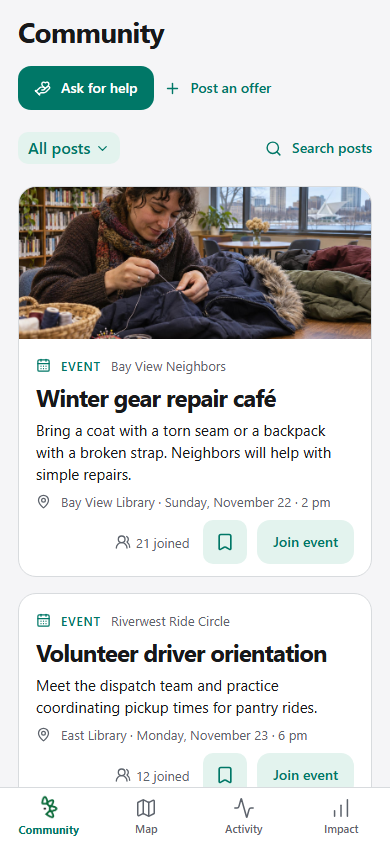
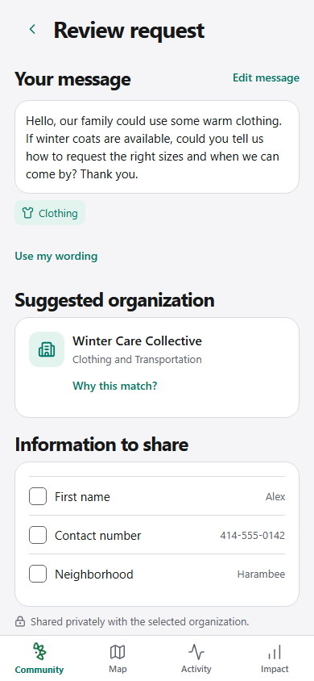
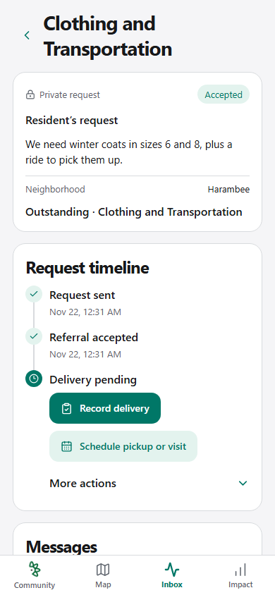
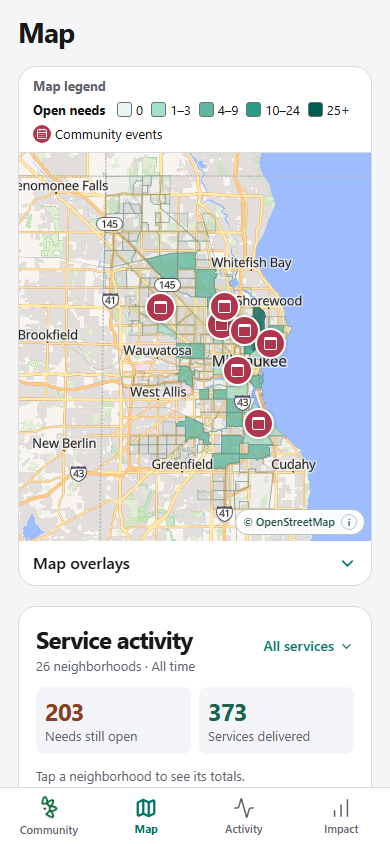
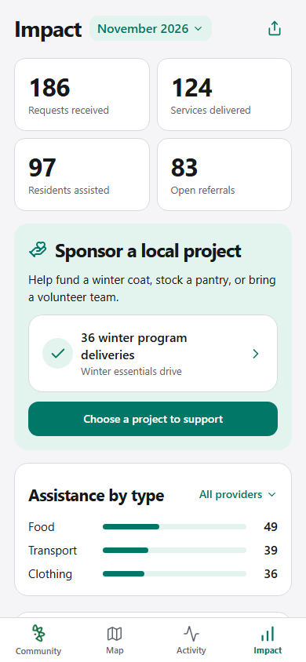
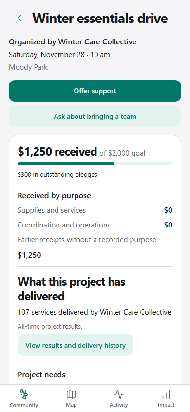

# ComForce Connect

ComForce Connect helps Milwaukee residents find local support and gives community organizations a shared way to coordinate and record the help they provide. A resident can request winter coats and a ride in one message. A partner can accept the request, confirm pickup in a private thread and record each service as it happens. Those records update the resident’s timeline, neighborhood service totals and ComForce’s impact reporting.

Built by **Winner Winner Chicken Dinner** for HacksGiving ComForce MKE.

**From voice to a routed request.** OpenAI Realtime transcribes spoken requests on mobile. ComForce Connect identifies the services a resident needs, recommends an organization that can help and routes the request privately after the resident reviews it.

| Community | Resident request review | Partner request timeline |
| --- | --- | --- |
|  |  |  |

| Milwaukee map | Impact reporting | Project sponsorship |
| --- | --- | --- |
|  |  |  |

## What you can do

| Area | Workflows |
| --- | --- |
| **Community** | Browse and search neighborhood events, offers and updates. RSVP, reserve a volunteer role, bookmark events, join neighborhood groups, publish an offer and reply to public posts. Event details show the venue, a bundled map and what to bring. |
| **Ask for help** | Type a request or speak it with **OpenAI Realtime transcription** on mobile. The app identifies needs, drafts a message when useful and automatically recommends a partner based on services, neighborhood coverage and availability. Review the recipient and sharing choices before sending. [How matching and routing work](docs/architecture.md#voice-matching-and-routing) |
| **Activity and partner inbox** | Track private requests in a timeline and message the assigned partner. Organization staff can see new, in-progress and historical requests, assign work, accept referrals, schedule pickups, record individual services and propose a handoff for resident approval. |
| **Community map** | Explore Milwaukee neighborhoods, community events, libraries, available resources and aggregate service activity. Use map layers to view historical public safety data alongside community activity. |
| **Impact** | Review requests, services delivered, residents assisted and open referrals by reporting period. See which organizations provided services, review program delivery history and share aggregate results. |
| **Business partnerships** | Sponsor a project such as **Winter essentials** or **Pantry meal kits**. Businesses can send a private inquiry, pledge funds for supplies or operations and offer volunteer places. Organizers confirm commitments, collect full or partial payments through Stripe Checkout and report funding and participation by project or business. [Sponsorship workflow and Stripe setup](docs/sponsorships.md) |
| **Organization directory** | Browse service and pickup information, submit an organization for review and manage approved listings. Organization administrators can review membership, update service availability and coordinate staff responsibilities. |

## Run the app

Use the Node.js version in [.nvmrc](.nvmrc), then install the pinned dependencies.

```sh
npm ci
npm run web
```

For **iOS or Android**, open the project in Expo Go. Run `npm run mobile:lan` on the same network or `npm run mobile:tunnel` for a phone on another network, then scan the QR code in the terminal. On the phone, swipe left from the right edge to open Settings and switch between the resident and partner profiles. On desktop, open Settings from the app brand or with `Alt+Shift+S`. [Phone setup and walkthrough](docs/mobile.md)

For **multi-device coordination**, run `npm run api` and set `EXPO_PUBLIC_API_URL` to the API address before starting the app. The shared workspace uses sign-in, role-scoped records and persistent server storage. [API setup and mobile release](docs/deployment.md)

## Start with a referral

1. As the **Resident**, open **Community → Ask for help**. Request children’s winter coats and a ride to pick them up. Review Winter Care Collective, select the neighborhood to share and send the request.
2. As the **Partner**, open **Inbox → New** and accept the request from its timeline. Scroll to **Messages** to confirm the pickup details. Record the clothing delivery, then record transportation separately.
3. Return to the **Resident** to see both deliveries on the timeline. Open **Impact** to see how the services roll up by category and provider. Open **Winter essentials** for funding and program delivery history.

## Engineering notes

The app uses Expo Router, React Native and TypeScript for iOS, Android and web. A shared domain model applies referral and service rules across the device workspace and the authenticated Node.js API. MapLibre renders the interactive Milwaukee map. Program metrics aggregate recorded services, and the sponsorship ledger tracks contributions and allocations separately.

Run `npm run check` for lint, types and tests. Run `npm run export:web` to generate `dist/` and `npm run preview` to serve it locally. [Architecture](docs/architecture.md) · [Map data and credits](docs/sources.md) · [Presentation walkthrough](docs/demo.md)
